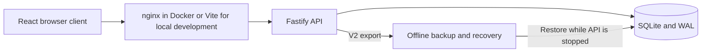

# Architecture and data protection

[Turkish version](tr/ARCHITECTURE.md)

TZR Cost Tracker is a TypeScript monorepo for per-project cost tracking. A React browser client calls a Fastify API. The API applies session, role, and project checks and uses a local SQLite database for persistence.

## Workspace map

| Path | Responsibility |
| --- | --- |
| `apps/web` | React application, project context, role-specific controls, reports, and API client. Vite builds static assets. |
| `apps/server` | Fastify routes, onboarding, JWT sessions, validation, authorization, accounting orchestration, and recovery CLI. |
| `packages/database` | Drizzle schema and repositories, SQLite transactions and migrations, data-directory lease, and recovery activation. |
| `packages/crypto` | AES-GCM protection, password hashing, blind-index helpers, TOTP, and audit hashing. |
| `packages/types` | Shared TypeScript data types and Zod input schemas. |
| `deploy` | nginx configuration, Compose deployment guidance, and a VPS pilot procedure. |

## Deployment data flow

In Compose, browser assets and API requests share an origin. nginx serves the built frontend and forwards `/api/*` and `/health` to the internal API service. The API runs without root privileges and owns the SQLite state in `/data`. The default Compose web port is bound to loopback. A remote deployment needs an operator-controlled TLS reverse proxy and explicit network policy. [Installation guide](INSTALL.md) · [VPS pilot](../deploy/VPS_PILOT_RUNBOOK.md)

In local development, the Vite server forwards API requests to the configured Fastify port. The API has its own health endpoint. Startup validates the server's process environment and database path. It acquires a data-directory lease, opens SQLite, and applies versioned migrations before serving requests. Use one API process per data directory. SQLite uses write-ahead logging for file-backed database state.

## Identity and access

The first-run wizard creates the first administrator, initial project, and starter settings. It requires a server-side bootstrap secret. Later accounts are created by an administrator. Standard login issues a signed JWT linked to an active database session. The API checks the session ID, expiry, revocation, and current user state. Protected operations check the current role and project membership. The browser's visible controls help users navigate these permissions. The API performs access enforcement.

Passwords are verified against scrypt hashes. TOTP enrollment is tied to the current user and session, and recovery codes are single-use. Logout and administrator revocation invalidate database sessions. The browser keeps credentials in the client session context and can clear or lock that context. Use trusted devices and protect browser access as part of the account policy. [API reference](API.md)

## Field protection and audit

The application applies server-side AES-256-GCM to selected sensitive fields. It uses keyed HMAC-SHA256 blind indexes for supported exact-match searches after normalization. Other SQLite fields remain readable to a process with database access. The server can decrypt protected fields using its keys. Secure the host, volume, and secrets accordingly. Use HTTPS between the browser and the operator's public reverse proxy.

The audit log stores a hash chain and protects selected before/after details. The admin verification endpoint checks the chain recorded in the database. Treat the audit chain as one integrity signal and retain independent operational evidence and backups for decisions that require external verification.

## Financial records and recovery

Projects organize transactions, accounts, and scoped views. Cash opening balances, transaction effects, and outstanding amounts have separate meanings. Where a financial mutation links multiple rows or an audit event, the affected route uses SQLite transactions to maintain consistency. For transaction creation, an idempotency key can attach a receipt to the financial mutation. Replays are evaluated against the live user's authorization and current records.

V2 backup protects supported database content with a separate vault password. The recovery command stages a new database for the target keys, preserves a verified rollback copy, and activates the candidate while the API is stopped. An interrupted activation can leave a recovery marker, and subsequent startup checks that marker. The protected database, keys, vault, password, and rollback copy each need an operator-controlled storage and retention policy. [Operations guide](OPERATIONS.md)
