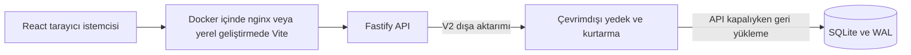

# Mimari ve veri koruması

[English version](../ARCHITECTURE.md)

TZR Cost Tracker proje bazında maliyet takibi için bir TypeScript monoreposudur. React tarayıcı istemcisi Fastify API'yi çağırır. API oturum, rol ve proje kontrollerini uygular ve kalıcı depolama için yerel SQLite veritabanını kullanır.

## Çalışma alanı dizinleri

| Yol | Sorumluluk |
| --- | --- |
| `apps/web` | React uygulaması, proje bağlamı, role göre kontroller, raporlar ve API istemcisi. Vite statik dosyaları derler. |
| `apps/server` | Fastify rotaları, ilk kurulum, JWT oturumları, doğrulama, yetkilendirme, mali işlemler ve kurtarma komutu. |
| `packages/database` | Drizzle şeması ve veri erişimi, SQLite işlemleri ve şema geçişleri, veri dizini kilidi, kurtarma etkinleştirmesi. |
| `packages/crypto` | AES-GCM koruması, parola özetleme, kör indeks yardımcıları, TOTP ve denetim özetleri. |
| `packages/types` | Ortak TypeScript veri türleri ve Zod girdi şemaları. |
| `deploy` | nginx yapılandırması, Compose kurulum yönergeleri ve VPS pilot adımları. |

## Dağıtım veri akışı

Compose kurulumunda tarayıcı dosyaları ve API istekleri aynı kök adresi kullanır. nginx derlenmiş arayüzü sunar ve `/api/*` ile `/health` isteklerini iç API hizmetine iletir. API root olmadan çalışır ve `/data` altındaki SQLite verilerini yönetir. Varsayılan Compose web portu yalnızca loopback adresine bağlanır. Uzak dağıtımda operatörün yönettiği TLS ters vekili ve açık ağ politikası gerekir. [Kurulum kılavuzu](INSTALL.md) · [VPS pilotu](../../deploy/VPS_PILOT_RUNBOOK.md)

Yerel geliştirmede Vite sunucusu API isteklerini yapılandırılmış Fastify portuna iletir. API'nin kendi sağlık noktası vardır. Sistem başlarken sunucu işlem ortamını ve veritabanı yolunu doğrular. Veri dizini kilidini alır, SQLite'ı açar ve istek almadan önce sürümlü şema geçişlerini uygular. Her veri dizini için tek API süreci kullanın. Dosyadaki SQLite verisi için WAL kullanılır.

## Kimlik ve erişim

İlk kurulum sihirbazı ilk yöneticiyi, başlangıç projesini ve ayarları oluşturur. Sunucu tarafında bir kurulum sırrı gerektirir. Sonraki hesapları yönetici açar. Normal giriş, etkin veritabanı oturumuna bağlı imzalı JWT üretir. API oturum kimliğini, süresini, iptal durumunu ve kullanıcının güncel durumunu kontrol eder. Korumalı işlemler geçerli rolü ve proje üyeliğini denetler. Tarayıcıdaki kontroller kullanıcının bu izinler içinde gezinmesini sağlar. Erişim denetimini API uygular.

Parolalar scrypt özetleriyle doğrulanır. TOTP kurulumu geçerli kullanıcı ve oturuma bağlıdır. Kurtarma kodları tek kullanımlıktır. Çıkış ve yönetici iptali veritabanı oturumlarını geçersiz kılar. Tarayıcı oturum belirtecini açık sayfanın belleğinde tutar. Sayfayı yenilediğinizde tekrar giriş yapmanız gerekir. Güvenilir cihaz kullanın ve tarayıcı erişimini hesap güvenliğinin bir parçası olarak koruyun. [API referansı](API.md)

## Alan koruması ve denetim

Uygulama seçili hassas alanlara sunucuda AES-256-GCM uygular. Desteklenen tam eşleşmeli aramalarda normalleştirmeden sonra anahtarlı HMAC-SHA256 kör indeksleri kullanılır. Diğer SQLite alanları veritabanına erişebilen bir süreç tarafından okunabilir. Sunucu, korunan alanları kendi anahtarlarıyla çözebilir. Ana makineyi, volume'ü ve sırları buna göre koruyun. Tarayıcı ve operatörün herkese açık ters vekili arasında HTTPS kullanın.

Denetim kaydı bir özet zinciri tutar ve seçili önceki/sonraki ayrıntılarını korur. Yönetici doğrulama rotası veritabanında kayıtlı zinciri denetler. Denetim zincirini bütünlük işaretlerinden biri olarak değerlendirin. Dış doğrulama gereken kararlar için bağımsız işletim kanıtı ve yedekleri saklayın.

## Mali kayıtlar ve kurtarma

Projeler işlemleri, hesapları ve kapsamlı görünümleri düzenler. Kasa açılış bakiyeleri, işlem etkileri ve ödenmemiş tutarlar ayrı anlamlar taşır. Mali değişiklik birden fazla satırı veya bir denetim olayını birbirine bağlıyorsa ilgili rota tutarlılığı korumak için SQLite işlemi kullanır. İşlem oluştururken idempotency anahtarı, mali değişiklikle birlikte bir kayıt tutabilir. Tekrar istekleri kullanıcının geçerli yetkisi ve mevcut kayıtlarla değerlendirilir.

V2 yedek, desteklenen veritabanı içeriğini ayrı vault parolasıyla korur. Kurtarma komutu hedef anahtarlar için yeni veritabanı hazırlar, doğrulanmış geri alma kopyasını korur ve API kapalıyken adayı etkinleştirir. Kesintiye uğrayan etkinleştirme kurtarma işareti bırakabilir. Bir sonraki başlatma bu işareti kontrol eder. Korunan veritabanı, anahtarlar, vault, parola ve geri alma kopyası için operatör denetiminde saklama ve süre politikası belirleyin. [İşletim kılavuzu](OPERATIONS.md)
